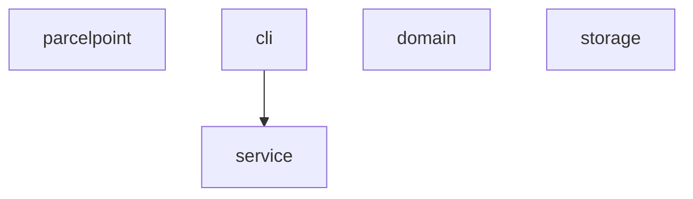
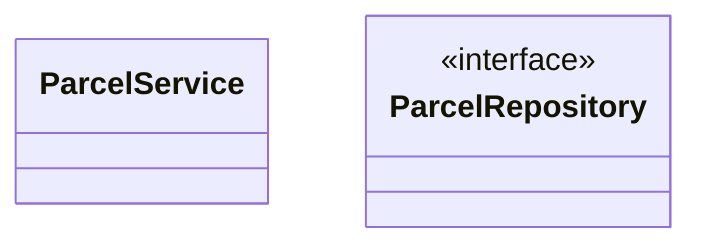
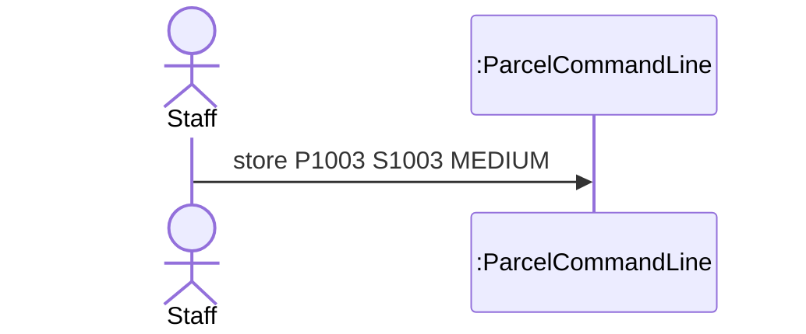

# Lab Report, Designing the Data Management Layer with H2

Repository URL: https://github.com/Paulinathequeen/itcs382-h2-lab.git

## Tools

| Item | Version or name |
| --- | --- |
| JDK | |
| Maven | |
| IDE | |
| AI tool and exact model, if you used one | |

## Part 0. From a store in memory to H2

Commit of the starter, before any change: a034138 

0.3 Your prediction for `staff`, written before the second run:

I predict that the `staff` command will show no parcels and all 3 lockers will be free. The data from the first run was only temporarily stored and is lost when the program is closed.

Output of the second run, for `staff` and `quit`:

```text
> staff
Free lockers: 3
> quit
```

State in one sentence where you think the parcels of the first run were kept.

The parcels were kept in the volatile memory (RAM) of the running program, which is cleared as soon as the program terminates.

0.5 The line of Main that you would change to keep the parcels somewhere else:

```java
ParcelRepository repository = new InMemoryParcelRepository();
```

0.6 Commit of the switch to H2: 62b2933 

0.7 Output of `SELECT * FROM PARCEL;` after you stored two parcels:

```CODE  | STUDENT_ID | PARCEL_SIZE | STATUS | LOCKER_NUMBER
P1001 | S1001      | SMALL       | STORED | 1
P1002 | S1002      | LARGE       | STORED | 3
(2 rows, 13 ms)

```

0.8 Explain why ParcelPoint could not start while the H2 Shell was open, and identify the class that wrote the message `Cannot create the PARCEL table`.

ParcelPoint could not start because H2 is an embedded database that locks its database file (`parcelpoint.mv.db`) so that only one program can access it at a time. Since the H2 Shell already had the database open, H2 denied access to the ParcelPoint program. The first line of the error was written by the constructor of the `H2ParcelRepository` class, which failed when trying to execute the `CREATE TABLE` statement.

0.9 Explain why `staff` shows no parcel while `find` shows each one, and why all three lockers look free.

The `find` command uses the `findByCode()` method, which is already fully implemented and reads directly from the H2 database. However, the `staff` command relies on the `findAll()` method, which is currently just a stub that returns an empty list (`List.of()`). Because the constructor of `ParcelService` populates the lockers using the result of `findAll()`, it receives no parcels, meaning no lockers are filled and they all appear free.

0.11 Your findAll method:

```java
@Override
public List<Parcel> findAll() {
    String sql = "SELECT * FROM PARCEL ORDER BY CODE";
    List<Parcel> parcels = new ArrayList<>();
    try (Connection connection = connect();
         PreparedStatement statement = connection.prepareStatement(sql);
         ResultSet row = statement.executeQuery()) {
        while (row.next()) {
            parcels.add(toParcel(row));
        }
    } catch (SQLException e) {
        throw new IllegalStateException("Cannot read the parcels", e);
    }
    return parcels;
}

```

Commit that adds findAll:

0.12 Output of `SELECT * FROM PARCEL;` after the pickup:

```text

```

0.13 Optional. Describe what `find P9999'OR'1'='1` showed while the SQL was joined from strings, and what it showed after you put the placeholder back.

## Part A. Model the design

A1 Complete the flowchart with one node for each package and one arrow for each dependency, from the package that uses to the package that is used. Mark the package that accesses the data store.



State whether cli depends on storage, and explain why.

A2 Complete the class diagram of the data management layer with ParcelService, the interface ParcelRepository with its three operations, and the two classes that implement it.



A3 Draw a sequence diagram for the command `store P1003 S1003 MEDIUM`, from the staff member to the repository. Show each message as an operation of the class that receives it.



Explain why the last lifeline is the interface ParcelRepository rather than H2ParcelRepository.

## Part B. Design questions

1. Identify the files that you changed to move from the store in memory to H2, and explain why no other class had to change. Use the terms of this course.

2. The PARCEL table stores the size of a parcel as SMALL, MEDIUM or LARGE rather than as 1, 2 or 3. Identify the type of connascence between ParcelSize and the table in each case, and explain which one is weaker.

3. Project Phase 2 asks for a data store that needs no separate server. Explain why an embedded database such as H2 meets this rule, and describe the limit of an embedded database that Step 0.8 showed.

4. State the data store that you would choose for your Project Phase 2 team, files or an embedded database, the requirement that drives the choice, and the package that will access it.

## AI usage declaration

| AI tool and exact model | Date | Purpose | Files or answers it produced or changed | How you checked its output |
| --- | --- | --- | --- | --- |
| | | | | |
